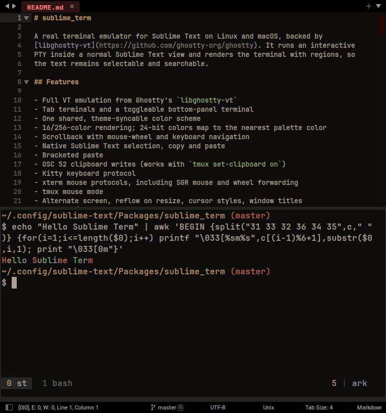

# sublime_term

A real terminal emulator for Sublime Text on Linux and macOS, backed by
[libghostty-vt](https://github.com/ghostty-org/ghostty). It runs an interactive
PTY inside a normal Sublime Text view and renders the terminal with regions, so
the text remains selectable and searchable.




## Features

- Full VT emulation from Ghostty's `libghostty-vt`
- Tab terminals and a toggleable bottom-panel terminal
- Hides the minimap while a terminal view is active, then restores it
- One shared, theme-syncable color scheme
- 16/256-color rendering; 24-bit colors map to the nearest palette color
- Native Sublime Text scrollback: scrollbar, Find and full-buffer selection
- Native Sublime Text selection, copy and paste
- Bracketed paste
- OSC 52 clipboard writes (works with `tmux set-clipboard on`)
- Kitty keyboard protocol
- xterm mouse protocols, including SGR mouse and wheel forwarding
- tmux mouse mode
- Alternate screen, reflow on resize, cursor styles, window titles
- Focus in/out events
- Command invocation from the palette or the command line
- Clickable file paths, including `path:line` and `path:line:column`
- Falls back to searching project root folders for unresolved filenames

Kitty graphics sequences are parsed by libghostty-vt, but Sublime Text has no
way to overlay raster images in a text view, so inline images are not drawn.

## Installation

Put this folder in Sublime Text's `Packages` directory (Preferences → Browse
Packages…). It must be a directory package, not a `.sublime-package`, because
the `libghostty-vt` library is loaded from the filesystem.

No prebuilt library is included. You must build `libghostty-vt` before using
the plugin:

```sh
python3 scripts/build_libghostty.py
```

On Windows use `py -3 scripts\build_libghostty.py`. The script builds the
host platform and installs the library into `lib/`: `libghostty-vt.so` on
Linux, `libghostty-vt.dylib` on macOS, or `ghostty-vt.dll` on Windows. It
requires Zig 0.17.0 and clones Ghostty at the pinned commit.

The library build script supports all three platforms. The interactive
terminal backend currently uses POSIX PTY APIs, so the plugin itself runs on
Linux and macOS.

## Usage

Open the command palette and run one of:

- `Terminal: New`
- `Terminal: New Here`
- `Terminal: Toggle Panel`
- `Terminal: Close Panel`
- `Terminal: Run Command…`
- `Terminal: Restart`
- `Terminal: Close`
- `Terminal: Copy`
- `Terminal: Paste`
- `Terminal: Clear Scrollback`
- `Terminal: Sync Color Scheme with Current Theme`
- `Terminal: Settings`

From the command line:

```sh
subl --command terminal_open
subl --command terminal_open_here
subl --command terminal_toggle_panel
```

`Terminal: Toggle Panel` opens an output-panel terminal at the bottom of the
window. Running it again hides the panel without stopping the shell. The panel
keeps its scrollback and running process, and can be brought back with the same
command. Bind it to a key in your user keymap if you want a shortcut:

```json
{ "keys": ["alt+`"], "command": "terminal_toggle_panel" }
```

The default key bindings only apply while a terminal view has focus:

| Keys | Action |
| --- | --- |
| `Ctrl+Shift+C`, `Ctrl+Insert` | Copy selection |
| `Ctrl+Shift+V`, `Shift+Insert` | Paste |
| `Ctrl+C` | Send SIGINT |
| `Ctrl+Shift+P` | Sublime Text command palette |
| `Ctrl+F` | Search the terminal buffer and scrollback |
| `Shift+PageUp` / `Shift+PageDown` | Scroll back / forward |
| `Ctrl+Shift+Up` / `Ctrl+Shift+Down` | Scroll one row |
| `Ctrl+Shift+Home` / `Ctrl+Shift+End` | Scroll to top / bottom |
| Mouse wheel | Scroll the terminal buffer (or forward to a mouse-aware app) |
| `Shift` + drag | Select text even when the app captures the mouse |
| `Shift` + right-click | Open the Sublime context menu instead of forwarding the click |
| Click on the input line | Move the terminal cursor to the clicked position |
| `Ctrl` / `Cmd` + click a path | Open the file, optionally at `:line` or `:line:column`; unresolved filenames are searched under project roots |
| Hover an existing file path | Underline it; `Ctrl` / `Cmd` + click opens it |

`Ctrl+Shift+C` and `Ctrl+Shift+V` can be remapped in your user keymap. On
macOS, `Cmd+C` and `Cmd+V` are also bound. `Ctrl+F` is reserved for Sublime
Text's Find panel and is not forwarded to the PTY.

Selecting text uses Sublime's native selection. Copying trims trailing spaces
from each selected line. Scrollback is mirrored into the Sublime buffer, so the
editor scrollbar, `Ctrl+F`, incremental find and selections work across the
entire history. Alternate-screen applications such as `micro`, `vim` and `less`
hide the scrollback while they are active, just like a normal terminal.

## tmux

tmux works out of the box. For mouse support and clipboard passthrough, use:

```tmux
set -g mouse on
set -g set-clipboard on
set -s extended-keys on
set -as terminal-features 'xterm*:extkeys'
```

Mouse clicks, drags and wheel events are forwarded when tmux enables mouse
tracking. Wheel scrolling enters tmux copy mode. Shift+wheel always scrolls the
outer terminal instead. Shift+right-click opens Sublime's context menu instead
of the application menu. Ctrl/Cmd+click opens file paths in output, and the
path is underlined on hover. Clicking the current input line repositions the
shell cursor when the application is not capturing the mouse. Using tmux's copy mode
with `set-clipboard on` copies through OSC 52 into Sublime Text's clipboard.


## Theme sync

On first run the plugin generates the terminal palette from the active Sublime
color scheme automatically. `Terminal: Sync Color Scheme with Current Theme`
does the same thing again after you change themes.

The generated files live outside the repository:

- `Packages/User/SublimeTerm/Terminal.sublime-color-scheme`
- `Packages/User/sublime_term_theme.json`

The scheme is written only when it is generated or synced, not while terminal
colors change. If multiple Sublime instances use different themes, the most
recent sync wins; use the same theme in all instances or avoid syncing while
instances differ.

## Settings

Settings live in `sublime_term.sublime-settings`:

```json
{
    "libghostty_path": "",
    "shell": "",
    "font_face": "",
    "font_size": 0,
    "line_height": 0,
    "scrollback_lines": 10000,
    "scrollback_bytes": 33554432,
    "close_on_exit": true
}
```

`libghostty_path` may be absolute or relative to `Packages`. If empty, the
package-local `lib/` directory is tried first, followed by `/opt/ghostty/lib`
and the system library directories. `SUBLIME_TERM_LIBGHOSTTY` overrides all of
them.

The terminal uses the editor's `font_face`, `font_size` and `line_height` by
default. Set these values in `sublime_term.sublime-settings` only to override
the editor font. The view is configured to hide gutter, line numbers, folding,
wrapping, indent guides and whitespace markers.

When `close_on_exit` is true, running `exit` (or otherwise terminating the
shell) closes the terminal tab or panel automatically.

## Architecture

- `term/ghostty.py` — ctypes binding for libghostty-vt: terminal, render state,
  key encoder, mouse encoder, clipboard and effect callbacks.
- `term/pty.py` — PTY process and non-blocking I/O.
- `term/session.py` — per-view terminal session, sizing, lifecycle and input.
- `term/render.py` — converts the libghostty screen into Sublime text and
  regions.
- `term/theme.py` — tracks the active palette, maps colors to region scopes,
  and loads/saves the theme sidecar used by the sync command.
- `term/scheme.py` — writes the generated scheme under
  `Packages/User/SublimeTerm/`.
- `term/palette.py` and `scripts/generate-color-scheme.py` — the default
  256-color palette and a standalone generator that writes to the User
  directory.
- `term/commands.py`, `term/listeners.py`, `term/keys.py` — commands and input
  integration.

The screen is rendered as one line per terminal row. Live rows are updated in
place; lines that scroll out of the viewport are appended to Sublime's buffer
so native scrolling, Find and selection cover the whole scrollback. The
alternate screen is rendered without the primary screen's history.

## License

MIT for this plugin. `libghostty-vt` and its shared library are MIT licensed;
see `LICENSES/Ghostty-MIT.txt`.
